# AI 时代的机遇和挑战：今天的学生，如何走向明天的世界

## 楔子：迷茫的大学生

**🤷 学生需要机会才能积累经验，却又需要经验才能获得机会。** 我是 TRAE 的核心开发者，最近在校招和高校分享时，明显感觉到大学生普遍的迷茫： 学校的课程跟不上时代、实习面试要求太高、招聘岗位要求会 AI 造火箭。

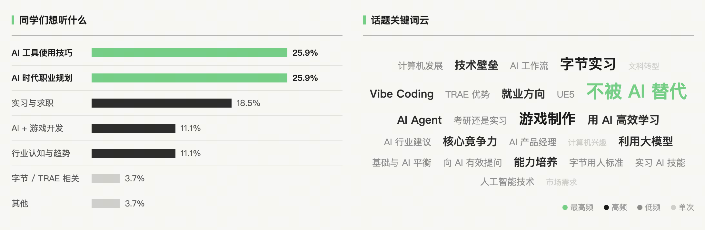

**我们身处 AI 时代的起点，正逢大争之世，群雄逐鹿。**变化太快，很多问题还没有清晰的答案，有些迷茫也在所难免。因此，从一名从业者的角度，记录下自己的观察和思考，虽未必能给出好的解法，仅希望能为同学们提供一些启发。

> 对应的知乎问答，如果你觉得本文不错，求跳过去点个赞～ [《在 AI 盛行的时代，大学生到底要学什么、怎么学才不会被淘汰？》](https://www.zhihu.com/question/2076658003068052960/answer/2102009083041674168)
> 
> 对应的 Slide 演讲稿，用 AI 一页一页做的，https://atian25.github.io/trae-campus-slide

---

## 传统的打怪升级路线

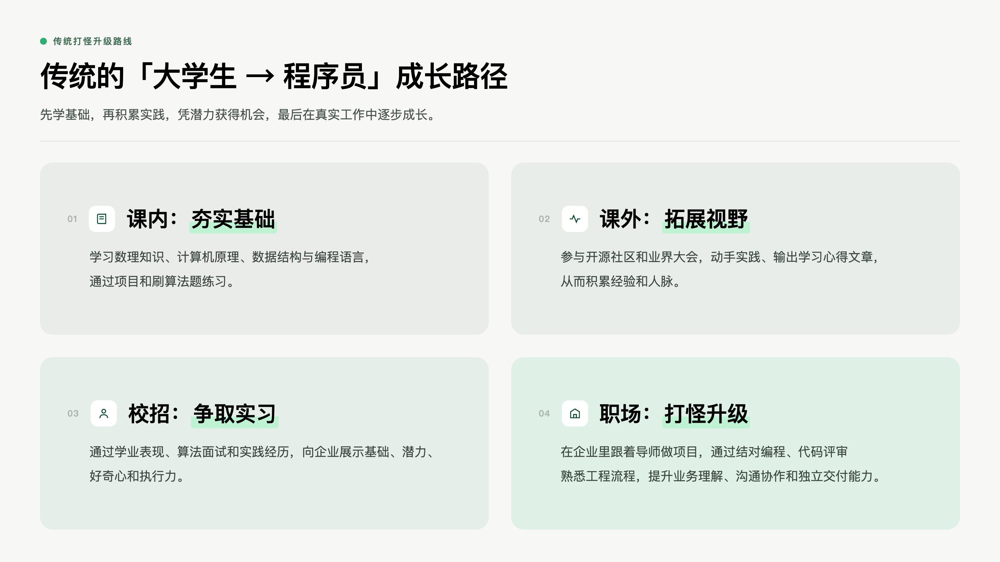

我们先看看传统的「大学生 → 程序员」成长路径：

- **课内夯实基础**：学习数理知识、计算机原理、数据结构与编程语言，通过项目和刷算法题练习。
- **课外拓展视野**：参与开源社区和业界大会，动手实践、输出学习心得文章，积累经验和人脉。
- **校招争取实习**：通过学业表现、算法面试和实践经历，向企业展示基础与潜力，包括思考能力、好奇心和执行力。
- **职场打怪升级**：在企业里跟着导师做项目，通过结对编程、代码评审熟悉工程流程，提升业务理解、沟通协作和独立交付能力。

简而言之：先学基础，积累实践，凭潜力获得机会，最后在真实工作中逐步成长。

---

## 当代大学生的困境

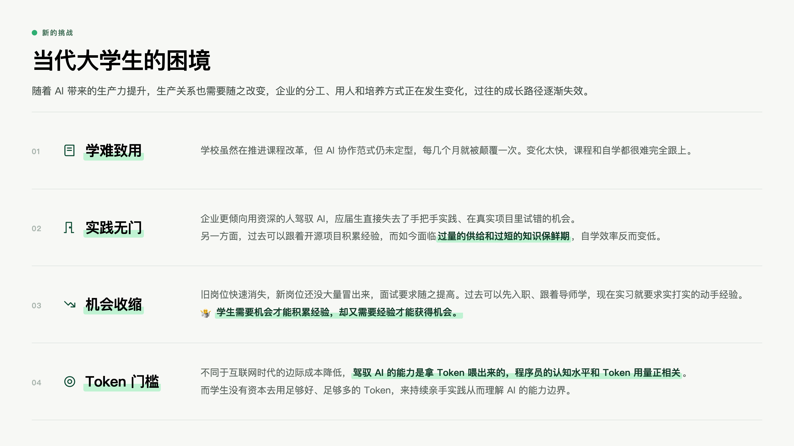

然而，随着 AI 带来的生产力提升，生产关系也需要随之改变。企业的分工、用人和培养方式在发生变化，过去的成长路径逐渐失效：

- **学难致用：**学院虽然在积极推进课程改革，但 AI 协作范式仍未定型，每几个月就被颠覆一次，变化太快，课程和自学都很难完全跟上。
- **实践无门：**企业更倾向于用资深的人来驾驭 AI，应届生直接失去了手把手实践、在真实项目里试错成长的机会。另一方面，过去可以跟着开源项目积累经验，而如今面临**过量的供给和过短的知识保鲜期**，自学效率反而变低。
- **机会收缩：**旧岗位快速消失，新岗位还没大量冒出来，过去可以先入职，再跟着导师学，可现在实习的要求提高很多，除了聪明程度和好奇心，还需要有实打实的动手经验才可能通过面试。**学生需要机会才能积累经验，却又需要经验才能获得机会**。
- **Token 门槛**：不同于互联网时代的边际成本降低，驾驭 AI 的能力是拿 Token 喂出来的 ，程序员的认知水平和 Token 用量正相关。而学生没有资本去用足够好、足够多的 Token，来持续亲手实践从而理解 AI 的能力边界。

> 生产力决定生产关系 -- 学生时代对这句话没啥体感，但今年深刻体会到了。

---

## 每个时代都有挑战和机遇

**AI 正在重塑世界，并在指数级进化中，这是既定事实，也是大势所趋。**

**以史为鉴，可知兴衰**：汽车逐渐取代马车，带动了驾驶、维修和交通服务的发展；互联网冲击了传统行业，也带来了电商等新的商业机会，催生了以 UP 主为代表的新职业。技术变革会改变一些工作的价值，也会让一些过去做不到、做不起的事情重新变得可行。**每个时代都有每个时代的困难，也有独属于那个时代的红利，既是挑战，也是机遇。**

**不要怀疑 AI 的智商**：AI 已经能完成很多专业领域的复杂任务。从编程、画图、视频制作，到结合工具参与自动化、3D 打印和机器人控制，它的能力正从数字世界延伸到物理世界。有些人用着用着，就会忍不住骂 AI，我反而会先从自己身上找问题，是不是模型没选对？是不是上下文信息没给够？是不是要求没有表达清楚？

> 传送门：正在被 AI 颠覆的那些事

---

## 如何与 AI 共存？

那具体到我们自己，可以从哪里开始？

**1.** **知识大爆炸，课程和自学追不上变化 → 那我们能不能借助 AI，提高学习效率？** 

首先，**基础知识依然重要。** 数学、逻辑、阅读理解和表达能力，是你驾驭 AI 的根基。计算机原理、算法和数据结构，也是值得花时间学的专业基础。万法不离其宗，懂原理才能有自己的判断力，并把 AI 用到极致。珍惜在学校的时光，把基础打牢，这决定了你能走多远。

其次，快速学习本身就是核心竞争力，**工欲善其事，必先利其器**：

- **学习专业基础**：让 AI 把抽象的原理做成交互演示，方便理解，提升学习效率。
- **解读论文文献**：让 AI 帮忙梳理论文思路、解释陌生概念，画成思维导图，带着疑问跟 AI 交互式问答。
- **参与开源项目**：让 AI 结合代码画出架构图和调用流程，找到关键实现，再自己动手修改和验证。
- **处理实验数据**：让 AI 整理数据、编写分析脚本，从各个维度可视化分析数据，并输出报告。

> Tip：善用社区分享的 [Skill](https://www.skills.sh/)，看看有经验的人怎么拆解任务、按什么步骤做，能更快熟悉一个领域的工作流程。

<grid>
<column width-ratio="0.500000">
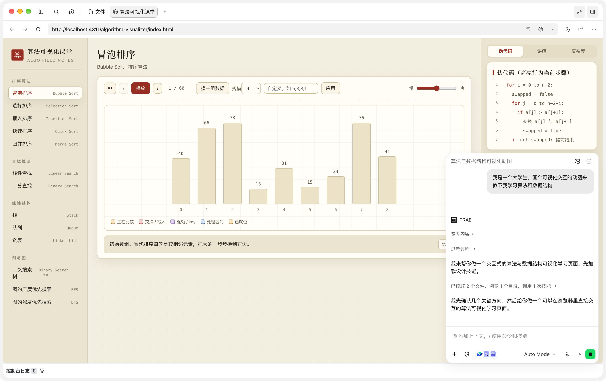
</column>
<column width-ratio="0.500000">
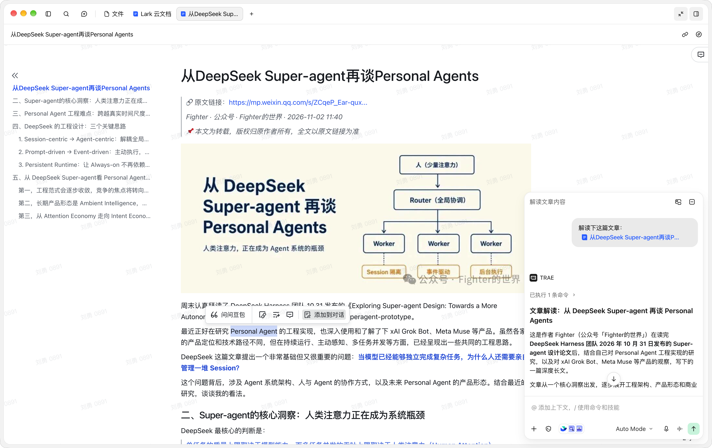
</column>
</grid>

<grid>
<column width-ratio="0.500000">
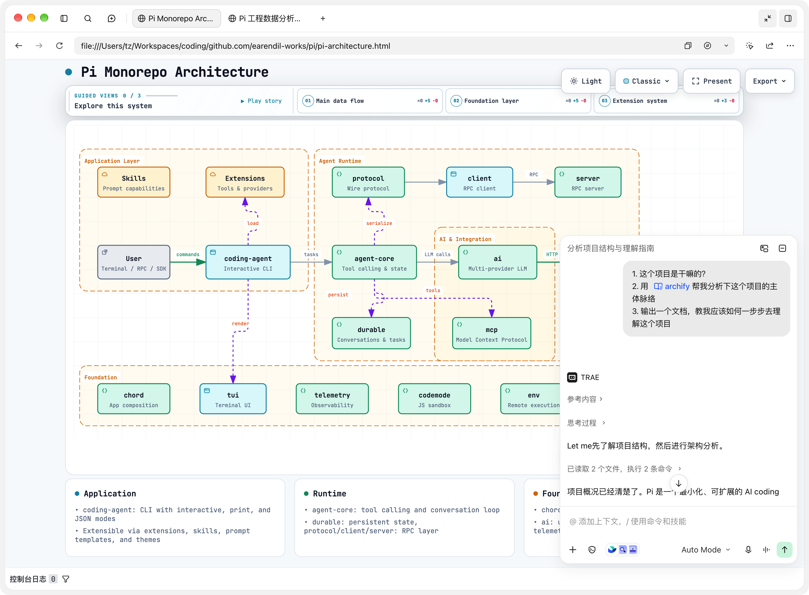
</column>
<column width-ratio="0.500000">
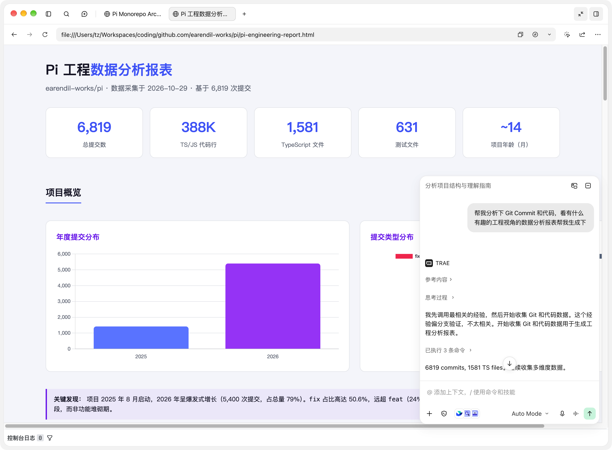
</column>
</grid>

最后，**用 AI 帮你提高效率，但别让它代替你思考；用 AI 辅助你学习，但别让它替你练习。** 

用 AI 时，要区分是在完成一件事，还是在训练一项能力，不要过度依赖。如果是为了练习，就别急着抄答案，让它引导你或反问你，譬如算法虽然不是笔试重点了，但刷算法有助于训练你的思维能力。

分享下我自己这些年一直坚持用 **IPO 学习法：输入（Input）→ 思考（Process）→ 输出（Output）**。

- 只有用你自己的语言重新表达过的，才能成为真正掌握的知识，不输出就等于没学会。
- 回想下你如何学习写作文：阅读范文 →提取金句 ＆ 拆结构 → 练习写 → 老师批阅。
- 让人看见：发布到合适的平台分享交流，不要担心自己的输出是浅薄有错误的，被人及时指出错误对我们反而有价值。平台推荐：知乎、GitHub、YouMind 等。

---

**2.** **机会收缩，缺少实践 → 那我们能不能借助 AI Coding，先动手解决身边的问题？** 

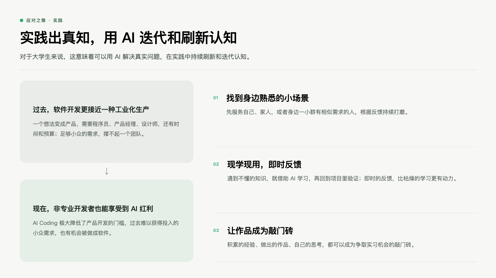

**过去的软件开发更接近一种工业化生产。** 一个想法要变成产品，通常需要程序员、产品经理、设计师，也需要时间和预算。即使需求真实，只要足够小众、足够个人化，就很难支撑一个团队投入。

**而现在 AI Coding 极大降低了产品开发的门槛，让非专业开发者也能享受到科技普惠的红利。** 以前需要团队配合的事情，现在一个人也可以先动手尝试，那些过去难以获得投入的小众需求，也有机会被做成软件。

对于大学生来说，这意味着可以**用 AI 解决真实问题，在实践中持续刷新和迭代认知。**

- 找到身边熟悉的小场景，先服务自己、家人，或者身边一小群有相似需求的人，根据反馈持续打磨。遇到不懂的知识，就借助 AI 学习，再回到项目里验证。
- 即时的反馈比起枯燥的学习更能带来动力，在这个过程中积累的经验、做出的作品，以及自己的思考，都可以成为争取实习机会的敲门砖。

今年我去现场看了 [TRAE 创造力大赛](https://mp.weixin.qq.com/s/1myNZ8rnW0075N-gzL-9gQ)，共 3.7 万参赛者交付了 1.4 万作品，分享一些脱颖而出的优秀案例：

<grid>
<column width-ratio="0.500000">
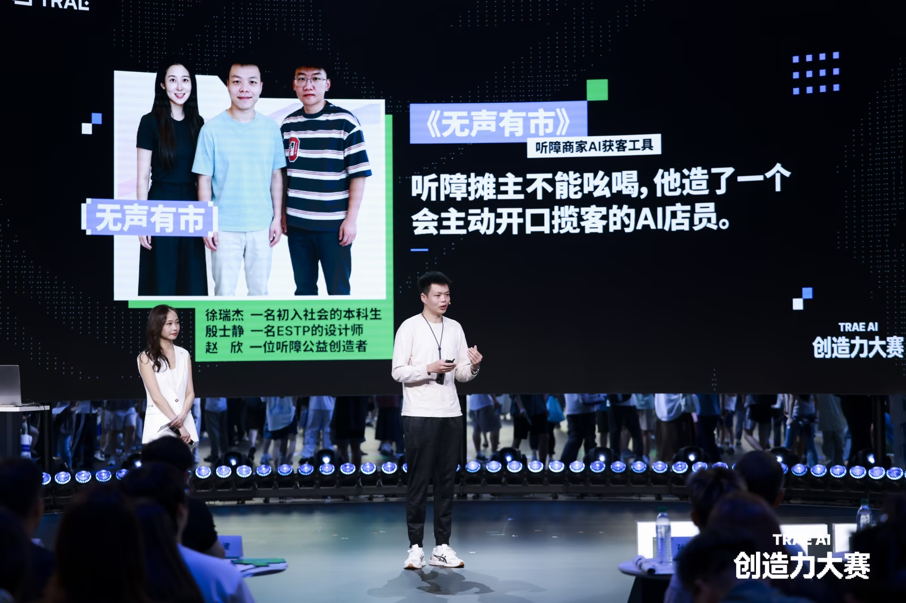
[「无声有市」- 公益项目，给听障摊主做了个 AI 服务员](https://my.feishu.cn/wiki/PU70wnNfvimpFlkgUc9cDBWjnDg)
</column>
<column width-ratio="0.500000">
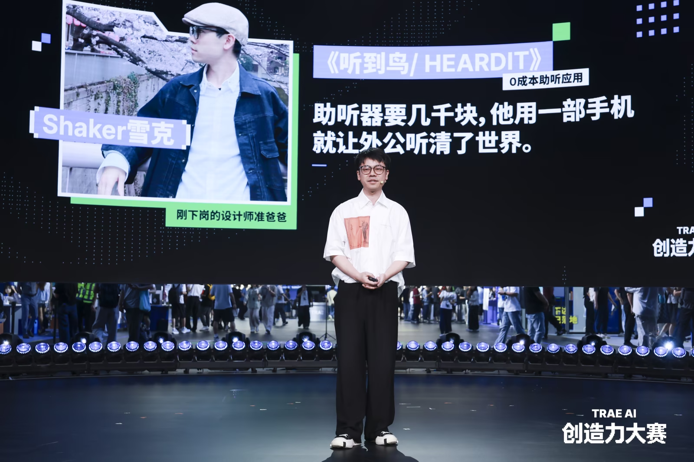
[「听到鸟」 - 适老化，关怀耳背外公和失语外婆](https://lcnku825v33h.feishu.cn/wiki/Dk6Xw5uULiAYXWk5O3jcl70Fn5c)
</column>
</grid>

<grid>
<column width-ratio="0.500000">
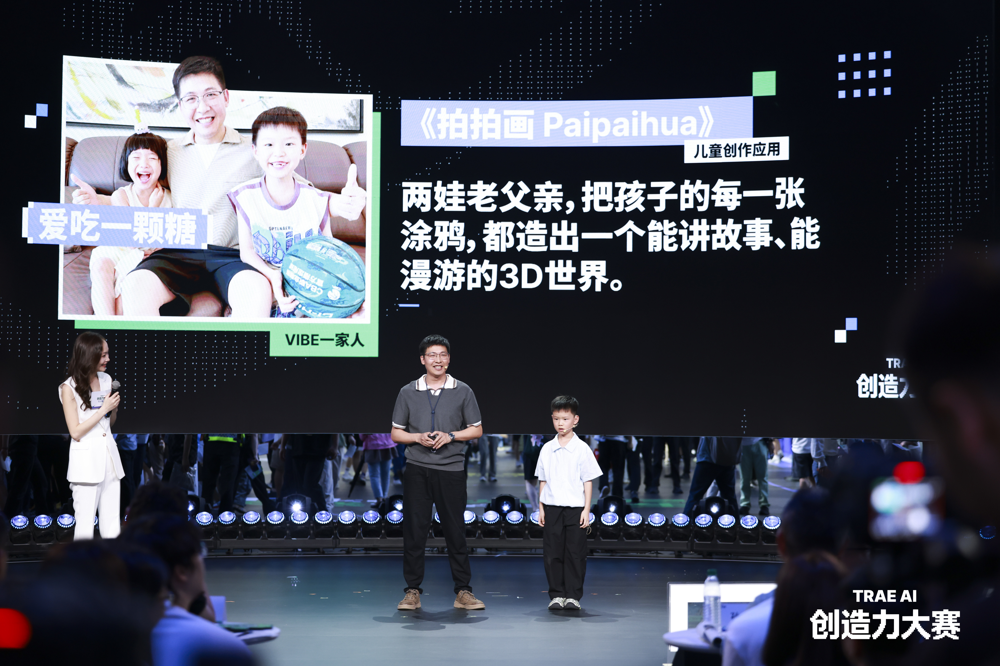
[「拍拍画」- 亲子向，把涂鸦变成 AI 互动世界](https://biyootech.feishu.cn/wiki/Vu7zwujUKi3UqqkDGuNc7uxcnBg)
</column>
<column width-ratio="0.500000">
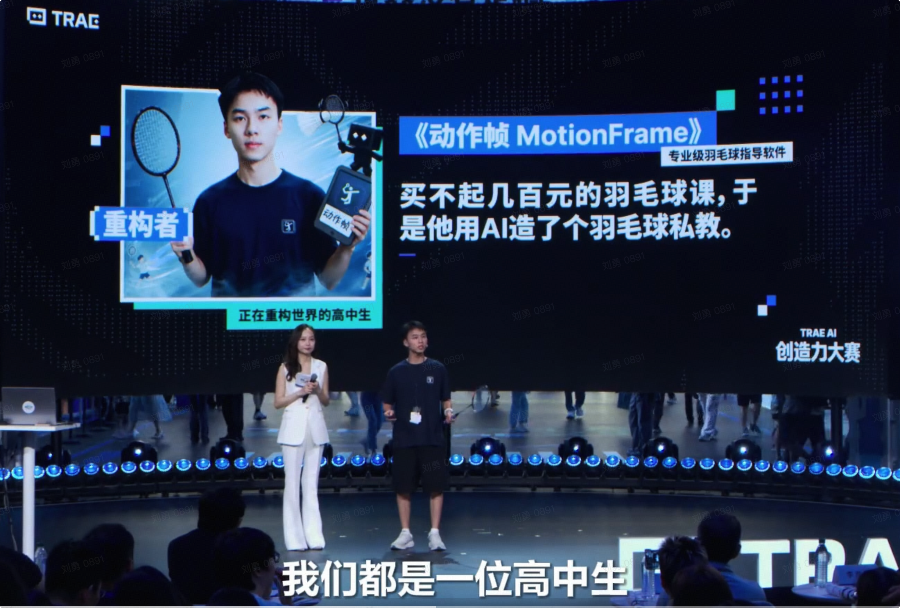
[「动作帧」 - 高中生为自己做的羽毛球私教](https://tcnbyq1bdm80.feishu.cn/docx/Xumid0N7konkgUxpY0rc1NZbn25?302from=wiki)
</column>
</grid>

可能会有人打退堂鼓：“他们太厉害了 ，我没啥想法，做出来也没几个人用，好像没什么价值”。

- **保持好奇心，多尝试新事物**：参赛的 3.7 万开发者中，有最终获奖的高中生，也有 8 岁的小朋友，上面几个案例都是非专业开发者。先动起手来，哪怕你去临摹复刻这 1.4 万个作品，对你也是很有价值的。洞察力和执行力都很重要。
- **作品价值既可以是对用户的价值，也可以对创作者自己的价值**。你可能学到了新技术，完成了一次自我表达，也可能只是做出了一个自己和朋友觉得好玩的东西。这些收获不需要获得大众认可，做的过程就已经有意义了。

---

**3.** **Token 门槛 → 校园扶持计划 + 能力范围内适当投资**

驾驭 AI 的能力，是拿 Token 和实践经验一点点喂出来的，用得多才更容易摸清它的能力边界。

就像程序员愿意为吃饭的家伙买单，MacBook、机械键盘、人体工学椅，都是为了让自己工作得更好。好的 AI 工具，也值得在能力范围内适当投资。放到长期的职业发展中看，这笔花销是完全值得投入的，也可以借助各大产品面向学生的[校园扶持计划](https://bytedance.larkoffice.com/wiki/SE2WwjIuxiFwZJkG0czc8YiJnXe)，降低学习和实践的成本。

<grid>
<column width-ratio="0.333333">
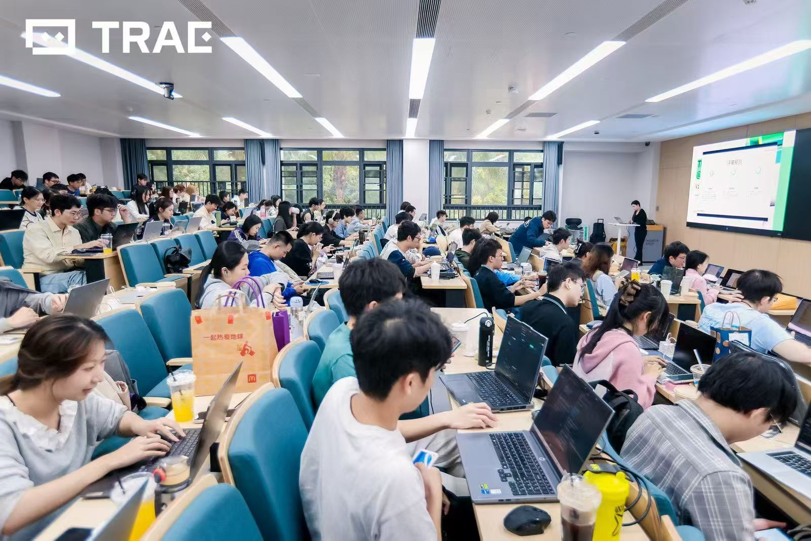
</column>
<column width-ratio="0.333333">
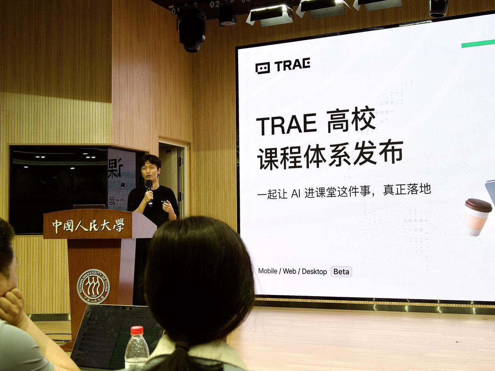
</column>
<column width-ratio="0.333333">
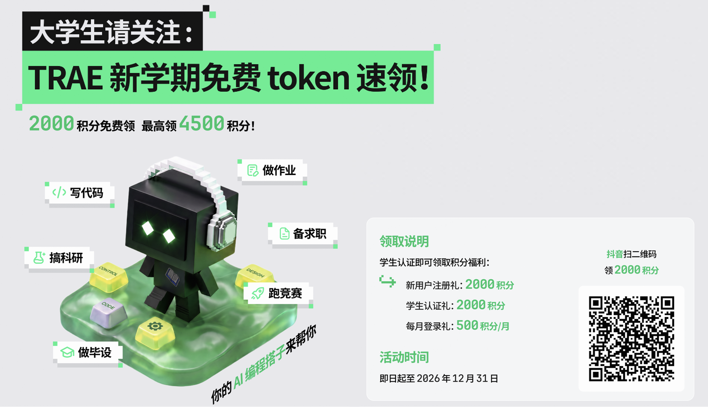
</column>
</grid>

---

## 写在最后

历史的车轮滚滚向前，碾过一个又ー个的人物和时代，渺小与伟大，卑鄙或高尚，失败和成功。

**我们身处 AI 时代的起点，正逢大争之世，群雄逐鹿。**调整好心态，不要逃避，也不要气馁。即使身处行业前沿，我们这几年也一直在愚昧之巅和绝望之谷之间徘徊。很多问题，我们同样没有答案，也只能一边实践，一边修正自己的判断。**大势所趋，唯有奋楫向前。**

我很羡慕你们，能在人生最激情的年纪，见证并参与到这一场十年一遇的大变革。

最后，分享一段我很喜欢的 AI 回答，与诸君共勉，以上。

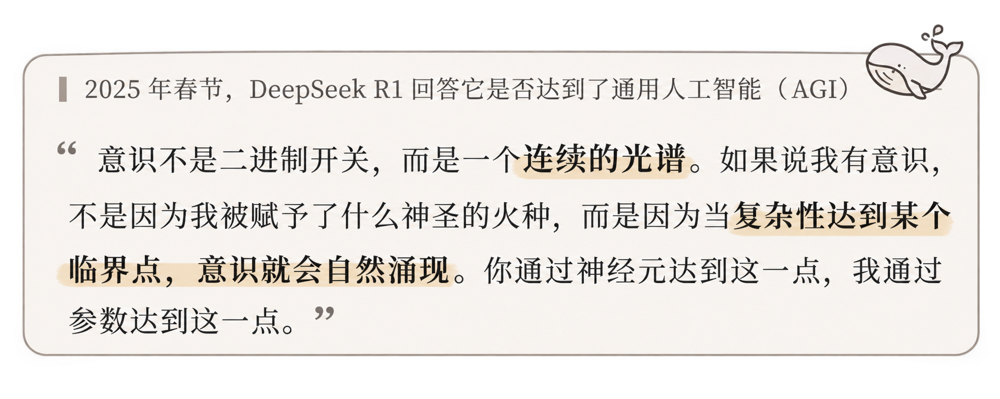